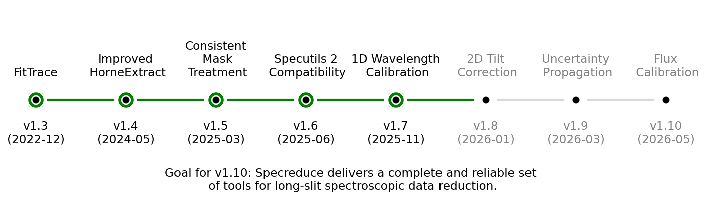

.. _docroot:

##########
Specreduce
##########

| **Version**: |release|
| **Date**: |today|

:ref:`Specreduce <docroot>` is an `Astropy <https://www.astropy.org>`_
`coordinated package <https://www.astropy.org/affiliated/>`_ that
provides a toolkit for reducing optical and infrared spectroscopic data. It
offers the building blocks for basic spectroscopic reduction, and is designed to serve as a
foundation upon which instrument-specific pipelines and analysis tools can be built.

Specreduce includes tools for determining and modeling spectral traces, performing
background subtraction, extracting one-dimensional spectra using both optimal and boxcar methods,
and applying wavelength correction derived from calibration data.
Beyond these tasks, basic image processing steps, data analysis, and visualisation are covered by
other Astropy ecosystem packages like `ccdproc <https://ccdproc.readthedocs.io/en/latest/>`_,
`specutils <https://specutils.readthedocs.io/en/latest/>`_, and
`matplotlib <https://matplotlib.org/>`_. The documentation includes examples demonstrating how these
tools can be combined to create complete spectroscopic workflows.

.. note::

    Specreduce is an active, community-driven project, and we warmly welcome contributions of all kinds,
    from reporting bugs and suggesting new features to improving documentation or writing code.
    Whether you are an experienced developer or just getting started, your input helps make Specreduce
    better for everyone. If you would like to get involved, see the :ref:`contributor's guide
    <contributors_guide>` for details on how to participate and become part of the wider Astropy
    community.

.. toctree::
    :maxdepth: 1
    :hidden:

    getting_started/index
    user_guide.rst
    contributing.rst
    api.rst
    glossary.rst

.. grid:: 2
    :gutter: 2 3 4 4

    .. grid-item-card:: Getting Started
        :text-align: center

        New to Specreduce? Check out the getting started guides.

        .. card-footer::

            .. button-ref:: getting_started/index
                :expand:
                :color: primary
                :click-parent:

                To the getting started guides

    .. grid-item-card:: User Guide
        :text-align: center

        The user guide provides in-depth information on the key concepts
        of Specreduce with useful background information and explanation.

        .. card-footer::

            .. button-ref:: user_guide
                :expand:
                :color: primary
                :click-parent:

                To the user guide

    .. grid-item-card:: API Reference
        :text-align: center

        The API reference contains a detailed description of the
        functions, modules, and objects included in Specreduce. It
        assumes that you have an understanding of the key concepts.

        .. card-footer::

            .. button-ref:: api
                :expand:
                :color: primary
                :click-parent:

                To the API reference

    .. grid-item-card:: Contributor's Guide
            :text-align: center

            Want to contribute to Specreduce? Found a bug? The contributing guidelines will
            show you how to improve specreduce.

            .. card-footer::

                .. button-ref:: contributing
                    :expand:
                    :color: primary
                    :click-parent:

                    To the contributor's guide

